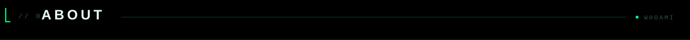
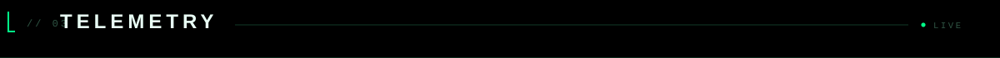
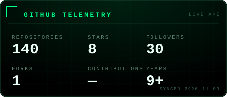
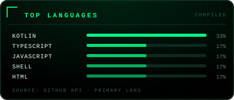
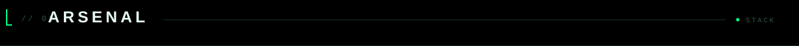
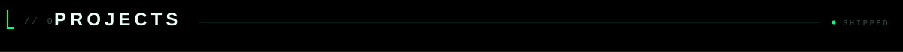
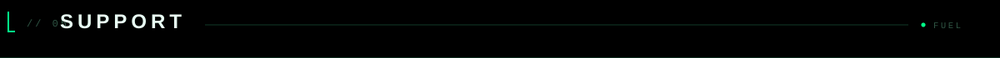

<div align="center">




<br>
<a href="https://github.com/iamtanzir"></a>
<a href="https://www.linkedin.com/in/akm-tanzir-ahmed"></a>
<a href="https://iamtanzir.github.io/"></a>
<a href="https://twitter.com/tanzir786"></a>

</div>



<div align="center">

```text
Life is short, but love is long.
Man is one, but humans are together.
Life is nothing without pain.
```

</div>

Senior DevOps Engineer from Dhaka, Bangladesh. I build, automate, and harden
cloud platforms, Kubernetes clusters, and delivery pipelines — so teams ship
fast without breaking production. Security-minded by default, reliability
obsessed at all times.

My day to day involves cloud infrastructure (AWS), container orchestration
(Kubernetes, Docker), infrastructure as code (Terraform, Ansible), GitOps
(Argo CD, GitHub Actions), observability (Prometheus, Grafana, ELK), and
practical DevSecOps — threat modeling, secret hygiene, supply-chain checks,
and sign-everything discipline.

- Cloud: AWS (EC2, EKS, S3, IAM, VPC, Lambda, Route53)
- Containers & Orchestration: Docker, Kubernetes, Helm, Kustomize
- IaC & Automation: Terraform, Ansible, Bash, Python
- CI/CD & GitOps: GitHub Actions, GitLab CI, Argo CD, Jenkins
- Observability: Prometheus, Grafana, ELK / OpenSearch, Loki
- Security: DevSecOps, Vault, Trivy, SAST/DAST, compliance mindset
- OS & Networking: Linux, Nginx, HAProxy, WireGuard, Cloudflare



<div align="center">

### LIVE — Dhaka, Bangladesh (BST · UTC+06:00)

**Black terminal. Green neon. AM / PM. Auto-ticking seconds.**


<br>

| Metric | Count |
|---|---|
| Profile views | [see badge above — auto-counted] |
| Countries visited | [flag counter below — auto-counted] |

<a href="https://s05.flagcounter.com/count/HlLE/bg_0A0E17/txt_00FF88/border_1E3A2A/columns_8/maxflags_12/viewers_0/labels_1/pageviews_1/flags_1/percent_0/"></a>

<br>
<sub>Every visit is counted automatically. The flag counter collects flags from every new country that views this profile, plus total pageviews.</sub>

<br><br>




</div>



<div align="center">


</div>



Selected work across 139+ public repositories. Highlights:

- **Platform engineering** — opinionated Kubernetes + Terraform blueprints,
  GitOps delivery, and cost-aware AWS foundations.
- **DevSecOps tooling** — security scanners, policy-as-code, and automated
  hardening bundled into CI pipelines.
- **Observability stacks** — Prometheus/Grafana dashboards tuned for real
  production traffic, not demo data.

Explore everything on the [Repositories tab](https://github.com/iamtanzir?tab=repositories).



<div align="center">

### Support my open source work

If this profile, my pipelines, or my configs saved you hours — you can
support the work via **SupportKori**:

<br>

<a href="https://www.supportkori.com/tanzirahmed"></a>

<br><br>

**In-person / coffee money:** [supportkori.com/tanzirahmed](https://www.supportkori.com/tanzirahmed)

<br><br>

| Method | Details |
|---|---|
| SupportKori | https://www.supportkori.com/tanzirahmed |
| GitHub | https://github.com/iamtanzir |
| LinkedIn | https://www.linkedin.com/in/akm-tanzir-ahmed |
| Website | https://iamtanzir.github.io/ |
| Email | tanzir.iu@gmail.com |

<sub>Every support goes directly into keeping open source DevOps tooling free and well maintained. Thank you.</sub>

</div>


---

<sub>Auto-updated by GitHub Actions: <code>scripts/clock.mjs</code> regenerates
the Dhaka clock every few minutes and <code>scripts/metrics.mjs</code> refreshes
telemetry cards daily. HTML in this README is intentionally minimal — all
graphics are pre-rendered SVG so they work everywhere GitHub renders Markdown.</sub>
