  
# DevOps Engineer — cloud · Kubernetes · CI/CD · automation

Bangladesh · UTC+06:00 · remote worldwide

[GitHub](https://github.com/iamtanzir) · [LinkedIn](https://www.linkedin.com/in/akm-tanzir-ahmed) · [Portfolio](https://iamtanzir.github.io/) · [SupportKori](https://www.supportkori.com/tanzirahmed) · [Twitter](https://twitter.com/tanzir786) · [Email](mailto:tanzir.iu@gmail.com)

---

## About

I build and run infrastructure: AWS, Kubernetes, Terraform, GitHub Actions.
I like things automated, observable, and that don't break at 2 am.

Outside work, I ship side projects — a laundry ERP, a multi-provider AI chat
app, and an Android app for monitoring solar panels and inverters.

**Stack:** AWS · Kubernetes · Docker · Terraform · Ansible · GitHub Actions · Argo CD · Prometheus · Grafana · Linux · Bash · Python · TypeScript · Kotlin

## Projects

| Project | What it is | Stack |
| --- | --- | --- |
| [Wash-ERP](https://github.com/iamtanzir/Wash-ERP) | Laundry ERP, deployed on Vercel + Turso | TypeScript |
| [tanzir-ai](https://github.com/iamtanzir/tanzir-ai) | Multi-provider AI chat (Gemini, Groq, OpenRouter, OpenAI, …) | JavaScript |
| [DeepSeek-v4-1-Flash-Free](https://github.com/iamtanzir/DeepSeek-v4-1-Flash-Free) | DeepSeek v4.1 Flash & Coder — notes + scripts | Shell |
| [IPS-Monitoring-System](https://github.com/iamtanzir/IPS-Monitoring-System) | IPS / hybrid inverter / solar monitoring | Kotlin |
| [LFP-Battery-Calculator](https://github.com/iamtanzir/LFP-Battery-Calculator) | LFP battery capacity & runtime calculator | Kotlin |
| [Pi-3B-setup-with-Earning-Apps](https://github.com/iamtanzir/Pi-3B-setup-with-Earning-Apps) | Raspberry Pi 3B + Pi-hole + Honeygain + EarnApp | DevOps |
| [BDIX-Tester](https://github.com/iamtanzir/BDIX-Tester) | BDIX server access tester | Tooling |
| [DNS-Server-List](https://github.com/iamtanzir/DNS-Server-List) | Ad-block DNS list | DNS |
| [Any-Theme-Template](https://github.com/iamtanzir/Any-Theme-Template) | Any Theme template clone | HTML / CSS / SCSS |
| [nextjs-blog-theme](https://github.com/iamtanzir/nextjs-blog-theme) | Minimal Next.js blog theme with Markdown | JavaScript |
| [SMS-Verification-Site](https://github.com/iamtanzir/SMS-Verification-Site) | SMS verification site | Web |
| [tanzir.iu](https://github.com/iamtanzir/tanzir.iu) | Personal site | Web |
| [iamtanzir](https://github.com/iamtanzir/iamtanzir) | This profile — clock, counters, CI | GitHub Actions |
| [Profile](https://github.com/iamtanzir/Profile) | GitHub profile config | Config |
| [Raspberry-Pi](https://github.com/iamtanzir/Raspberry-Pi) | Raspberry Pi notes | Hardware |

More on the [Repositories tab](https://github.com/iamtanzir?tab=repositories).

## Live clock

## Visitors

## Support

If my work helped you, you can support via **SupportKori**:

👉 [supportkori.com/tanzirahmed](https://www.supportkori.com/tanzirahmed)

| Contact | Link |
| --- | --- |
| SupportKori | https://www.supportkori.com/tanzirahmed |
| GitHub | https://github.com/iamtanzir |
| LinkedIn | https://www.linkedin.com/in/akm-tanzir-ahmed |
| Portfolio | https://iamtanzir.github.io/ |
| Email | tanzir.iu@gmail.com |

---

Clock auto-updates every 5 minutes via GitHub Actions.
